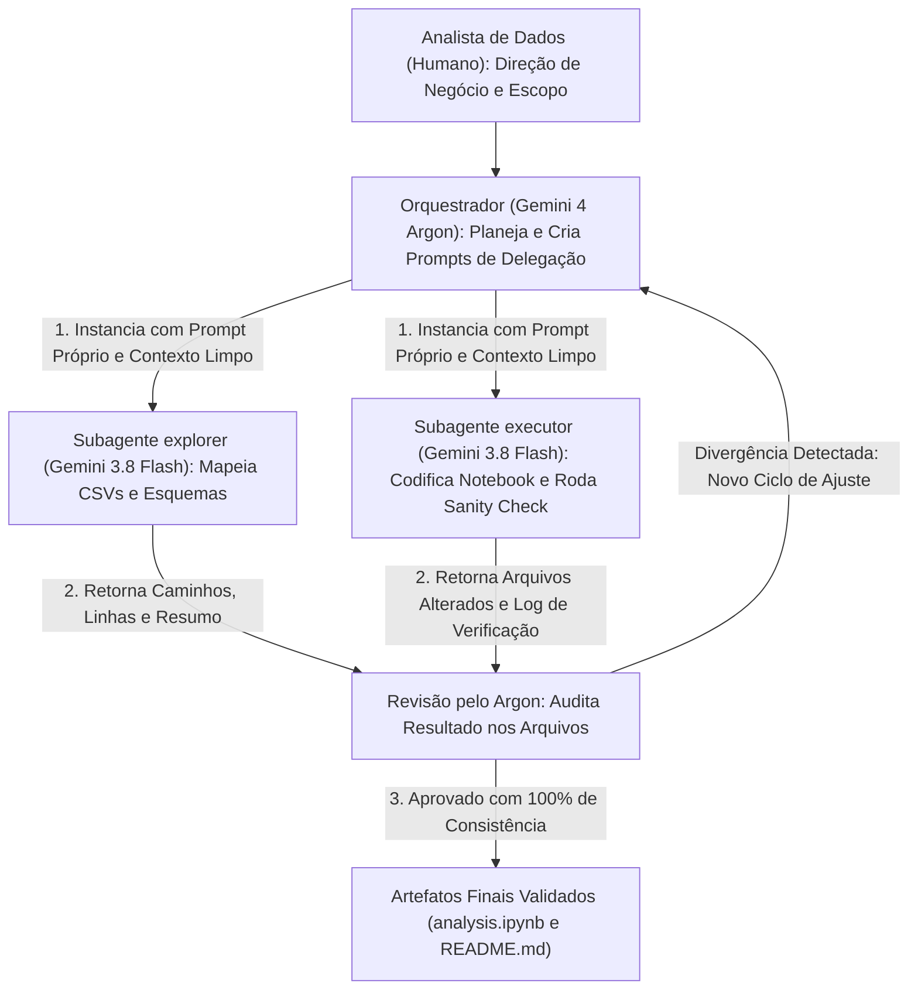
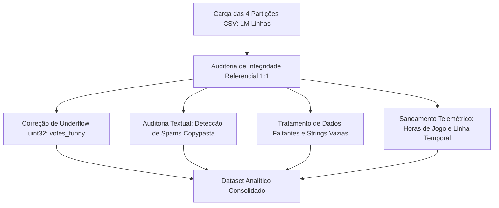
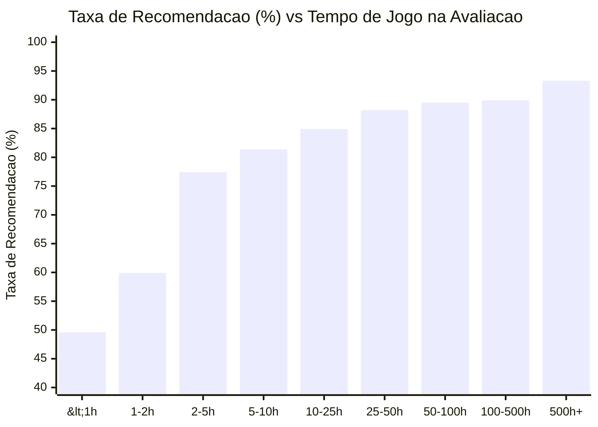

# Steam Game Reviews: análise exploratória de dados (1 milhão de reviews)

Análise de 1.000.000 de avaliações da Steam, de março de 2013 a janeiro de 2021, a partir do [Game Reviews Dataset](https://www.kaggle.com/datasets/sridharstreaks/game-reviews-dataset). A base cobre 59 jogos e 912.553 autores. O estudo mede a consistência entre as tabelas, a diferença entre quem recomenda e quem não recomenda, e o tempo de jogo.

A Steam é a principal loja digital de jogos para computador, com centenas de milhões de usuários ativos por mês e dezenas de milhares de títulos. A avaliação pesa na visibilidade do jogo, no algoritmo de recomendação e na compra.

A análise é assistida por IA. O escopo ficou mais solto do que um roteiro fechado de perguntas: o teste era o que o Gemini 4 Argon recuperava dos CSV sem um dicionário de dados. Os subagentes `explorer` e `executor` usam o Gemini 3.8 Flash para ler os arquivos e escrever o notebook. O protocolo está em `AGENTS.md`.

[](assets/overview.mp4)

## 1. Metodologia do experimento

O modelo da conversa principal é o Gemini 4 Argon. Em 13 de outubro de 2026, a Google o lançou para uso geral como modelo de fronteira para trabalho longo em código, finanças, direito e ciência. No [model card](https://deepmind.google/models/model-cards/gemini-4-argon/) daquele mês, o Argon lidera a tabela de comparação no [Vals Index](https://www.vals.ai/benchmarks/vals_index) (68,9%, contra 67,0% do Claude Opus 5.5 e 63,1% do GPT-6 Astra) e em Chartography, leitura de gráficos (71,6%, contra 71,0% e 66,3%). No [exame de análise de dados da Plotly](https://plotly.com/blog/gemini-4-argon-plotly-data-analytics-bench/), publicado no mesmo dia, o Argon acertou 41 de 43 questões (95%) e achou os 5 padrões escondidos na base, sem aviso para procurá-los. Até aquela data, só o GPT-6.1 Sol e o GPT-6 Astra tinham fechado os 5. O total de 41 não era o maior da prova: Sol e Astra fecharam 43 de 43.

Em 30 de outubro de 2026 o [Gemini 4 Carbon](https://blog.google/innovation-and-ai/models-and-research/gemini-models/introducing-gemini-4-carbon/), anunciado em 28 de outubro, lidera o Artificial Analysis Intelligence Index v5.0 com 59, contra 50 do Argon, na [tabela da DeepMind](https://deepmind.google/models/gemini/). Nesse dia ele ainda não está no uso geral. A Google libera o Carbon primeiro a um grupo de defensores de cibersegurança pelo [Fairwind](https://deepmind.google/fairwind-program/), e só depois a desenvolvedores, empresas e consumidores, sem data publicada. Para quem usa o Gemini no produto, o Argon, aberto ao público desde 13 de outubro, é o modelo de fronteira acessível. Esta análise ficou nele.

O experimento daqui não usa a nota desses exames. O `AGENTS.md` e o prompt inicial não descrevem as colunas nem a relação entre as tabelas. O arquivo só define a delegação: quando chamar um subagente, o que o prompt leva (objetivo, arquivos, critério de pronto e comando de verificação) e o que volta. O `explorer` devolve caminhos, linhas e um resumo. O `executor` devolve os arquivos alterados e o log da verificação.

Lendo os arquivos, o Argon e o Flash chegaram à partição vertical 1:1 por `review_id`, ao underflow `uint32` em `votes_funny`, ao spam de copypasta e ao efeito da janela de reembolso de 2 horas. Nesse critério, o experimento fechou: os quatro achados saíram dos CSV, sem dicionário, e a revisão conferiu o resultado nos arquivos.

Em produção, o `AGENTS.md` leva uma descrição curta dos dados: granularidade, regras de negócio já conhecidas e a pergunta da análise. Neste estudo essa descrição ficou de fora.

Na mesma conversa, um agente só acumula leitura integral de arquivo, saída do Pandas, traceback e o JSON do notebook. Nesta análise, o Argon escreveu um prompt fechado para cada tarefa. O subagente começou sem o histórico anterior. O `explorer` só leu. O `executor` gravou o `analysis.ipynb`, subiu o kernel do JupyterLab e rodou a verificação. O Argon conferiu o relatório em `analysis.ipynb` e neste `README.md` antes de aceitar. Métrica divergente reabria o ciclo. No sanity check, o Flash escreveu e rodou o script. O que entrava no teste, e a leitura do resultado, ficaram com o Argon.



O resultado ficou no mesmo nível, ou acima, de deixar o modelo principal fazer a análise inteira, com menos uso da cota dele. A execução ficou fora da janela do Argon, e a revisão pegou o underflow de `votes_funny`, os textos de copypasta com milhões de caracteres e as horas de `playtime` fora de ordem.

| Camada | Papel / modelo | Onde atua | Cota e qualidade |
| :--- | :--- | :--- | :--- |
| Direção analítica | Analista (humano) | Problema, hipóteses de negócio e validação. | Mantém a análise no domínio do produto. |
| Orquestração e revisão | Gemini 4 Argon | Plano, prompt de delegação e auditoria dos arquivos. | A cota do modelo principal fica na decisão e na revisão. |
| Exploração | `explorer`, Gemini 3.8 Flash | Varredura dos CSV, colunas, tipos e `review_id`. | A leitura bruta fica fora da conversa principal. |
| Execução e sanity check | `executor`, Gemini 3.8 Flash | Pandas, Seaborn, kernel, gráficos e scripts de verificação. | Código e checagem repetida ficam sob revisão do Argon. |

## 2. Estrutura do repositório

O ambiente usa o [uv](https://github.com/astral-sh/uv), com as versões fixadas no `pyproject.toml` e scripts para subir o JupyterLab.

O `review_info.csv` passa de 360 MB, acima do limite de arquivo do GitHub. A pasta `data/` está no `.gitignore`. Para reproduzir, baixe o [Game Reviews Dataset](https://www.kaggle.com/datasets/sridharstreaks/game-reviews-dataset) e coloque os 4 CSV em `data/`.

```text
game-review/
├── assets/                               # Resumo visual animado do experimento (GIF e MP4 1080p)
│   ├── overview.gif                      # Animação inline para o README
│   └── overview.mp4                      # Vídeo completo em alta definição (1920x1080)
├── data/                                 # Partições relacionais dos dados (1:1 - baixadas via Kaggle)
│   ├── review_info.csv                   # Texto, votos, recomendação e engajamento (10 colunas, ~364 MB)
│   ├── game_info.csv                     # Identificação dos jogos (app_id e app_name) (3 colunas, ~28 MB)
│   ├── author_info.csv                   # Perfil do autor e telemetria de jogo (8 colunas, ~58 MB)
│   └── purchase_info.csv                 # Forma de aquisição e early access (4 colunas, ~10 MB)
├── scripts/                              # Scripts de inicialização do JupyterLab
│   ├── start-jupyter.ps1                 # Inicialização no Windows PowerShell
│   └── start-jupyter.sh                  # Inicialização no Linux / macOS Bash
├── analysis.ipynb                        # Notebook analítico com validações e visualizações
├── pyproject.toml                        # Definição do projeto e dependências gerenciadas pelo uv
├── AGENTS.md                             # Protocolo operacional e diretrizes de agentes
└── README.md                             # Documentação técnica do projeto
```

## 3. Arquitetura relacional e dicionário de dados

Os quatro CSV são uma partição vertical indexada por `review_id`.

Cada partição tem 1.000.000 de linhas e 1.000.000 de `review_id` distintos. A interseção das quatro chaves também é 1.000.000, com zero registros órfãos ou ausentes. As quatro tabelas compartilham a mesma ordenação física de linhas, e a junção por chave primária aproveita essa ordem.


| Partição | Linhas | Colunas | Memória | Variáveis principais e descrição |
| :--- | :---: | :---: | :---: | :--- |
| `review_info.csv` | 1.000.000 | 10 | 487,7 MB | `review_id`, `language`, `review`, `timestamp_created`, `timestamp_updated`, `recommended`, `votes_helpful`, `votes_funny`, `weighted_vote_score`, `comment_count`. Métricas textuais e de engajamento comunitário. |
| `game_info.csv` | 1.000.000 | 3 | 82,4 MB | `review_id`, `app_id`, `app_name`. Metadados do catálogo. Contém 59 jogos únicos, com correspondência biunívoca entre `app_id` e `app_name`. |
| `author_info.csv` | 1.000.000 | 8 | 61,0 MB | `review_id`, `author.steamid`, `author.num_games_owned`, `author.num_reviews`, `author.playtime_forever`, `author.playtime_last_two_weeks`, `author.playtime_at_review`, `author.last_played`. População de 912.553 autores únicos (92,47% com 1 review; maior volume por autor é de 22 reviews). |
| `purchase_info.csv` | 1.000.000 | 4 | 10,5 MB | `review_id`, `steam_purchase`, `received_for_free`, `written_during_early_access`. Contexto contratual e modalidade de aquisição do título. |

## 4. Limpeza dos dados

Antes das estatísticas, a carga passou por checagem de integridade, contadores, texto, nulos e horas de jogo.



### Underflow de `uint32` em `votes_funny`

O contador de votos "engraçado" foi gravado na origem como inteiro de 32 bits sem sinal. Quando a API decrementava (por exemplo, -1, -2, -3, -4), o valor virava um número perto de $2^{32} - 1 = 4.294.967.295$. São 49 registros entre 4.294.967.292 e 4.294.967.295. A coluna `votes_funny_clean` troca valores $\ge 4.294.967.292$ por 0. O máximo real depois da correção é 8.983 votos.

### Texto em copypasta

A interface atual da Steam limita a avaliação a 8.000 caracteres. Clientes antigos, ou chamadas diretas, publicaram repetição em massa. Duas avaliações têm 9.639.004 caracteres (*Arma 3*) e 4.971.225 (*For Honor*). Com elas, a média de tamanho sobe para 265 caracteres, com desvio padrão de 10.861. A mediana é 63 caracteres, e 99% das avaliações ficam abaixo de 2.958. Para NLP, o texto pode ser truncado em 8.000 caracteres.

### Ausências

`review` tem 1.294 nulos (0,13%) e mais 174 textos só com espaço: 1.468 sem texto útil (0,15%). `author.playtime_at_review` tem 1.248 nulos (0,12%), sem telemetria no instante da publicação. O campo de texto nulo foi preenchido com string vazia. As análises de correlação temporal filtram esses casos à parte.

### Horas de jogo e tempo

Em 116 registros (0,01%), `playtime_at_review` passa de `playtime_forever`. O tempo jogado depois da avaliação usa $\max(0, \text{playtime\_forever} - \text{playtime\_at\_review})$. Dois registros têm `author.last_played == 0`, o marco Unix `1970-01-01 00:00:00 UTC`. `timestamp_created` comparado com `timestamp_updated` marca `is_edited` em 13,11% das avaliações.

## 5. Descobertas

### Concentração do catálogo

Cinco jogos concentram 54,65% das avaliações (546.549): Arma 3, The Elder Scrolls V: Skyrim Special Edition, For Honor, Darkest Dungeon e NieR:Automata.

Maior taxa de recomendação: *STEINS;GATE 0* (96,5%), *The Legend of Heroes: Trails of Cold Steel II* (95,2%) e *Farm Together* (93,8%). Menor: *SOS* (27,8%), *DYNASTY WARRIORS 9* (31,2%) e *Bless Online* (38,0%).

### Avaliações negativas ("Economia da Insatisfação")

A base é positiva: 82,97% de recomendações, contra 17,03% de negativas.

| Métrica | Avaliação positiva | Avaliação negativa | Comparação |
| :--- | :---: | :---: | :--- |
| Proporção na base | 82,97% | 17,03% | ~4,9 para 1 |
| Probabilidade de receber voto útil (> 0) | 31,6% | 63,3% | 2,0x mais provável |
| Média de votos úteis recebidos | 2,56 votos | 7,08 votos | 2,8x mais votos úteis |
| Mediana do tamanho do texto | 57 caracteres | 112 caracteres | ~2,0x mais longo |
| Média de comentários recebidos | 0,13 comentários | 0,55 comentários | 4,25x mais comentários |
| Mediana de tempo jogado pós-avaliação | 13,98 horas | 1,18 horas | 11,8x menos tempo jogado |

O texto negativo, com o dobro da mediana, costuma descrever problema técnico, balanceamento ou monetização. Depois da review negativa, a mediana de tempo jogado é 1,18 hora, contra 13,98 horas de quem recomendou.

### Janela de reembolso de 2 horas

A Valve devolve a compra se o jogador ficou menos de 2 horas no jogo. Abaixo de 1 hora, a recomendação é 49,6%. De 1 a 2 horas, 59,9%. Essas reviews cedo têm a maior média de votos úteis da base, 4,77, e outros compradores as usam como alerta antes de comprar. Passadas as 2 horas, a aprovação vai a 77,4% (2 a 5 horas) e chega a 93,3% acima de 500 horas. Quem ficou depois do limite de reembolso já tinha interesse no jogo.



### Compra, Acesso Antecipado e edições

Avaliações escritas no Acesso Antecipado têm 69,8% de aprovação, contra 83,8% nos títulos já em versão estável. A diferença é de 14,0 pontos percentuais.

As avaliações editadas são 13,11% da base. A recomendação delas é 74,3%, contra 84,3% nas que não foram editadas. O texto médio tem 769,9 caracteres, contra 188,9, e a média de votos úteis é 8,43, contra 2,56 (3,3 vezes).

Compra direta na loja Steam: 83,8% de aprovação. Chave de ativação externa: 81,2%. Jogo recebido de graça: 78,7%, contra 83,2% nos pagos.

### Quem escreve muitas avaliações, e o idioma

Autor com 1 avaliação na conta: 84,9% de aprovação e média de 2,14 votos úteis. Autor com mais de 50 avaliações: 76,8% de aprovação (queda de 8,1 pontos percentuais) e 7,09 votos úteis (3,3 vezes a média de quem tem uma só).

| Idioma | Fatia da base | Aprovação | Média de votos úteis |
| :--- | :---: | :---: | :---: |
| Inglês | 49,1% | 83,7% | 3,07 |
| Chinês simplificado | 15,1% | 76,6% | 6,15 |
| Russo | 8,7% | 82,1% | 4,02 |
| Português brasileiro | 2,8% (27.965 avaliações) | 88,2% | 2,11 |

### Sazonalidade

Entre 2017 e 2020, os meses de promoção da Valve concentram reviews novas. Na Steam Summer Sale, junho de 2018 teve 40.674 reviews e julho de 2019 teve 33.620. No outono e no inverno, novembro de 2018 teve 40.418, novembro de 2019 teve 46.169 (o maior mês da série) e dezembro de 2019 teve 34.410.

## 6. Como executar

### Pré-requisitos

- [Python](https://www.python.org/) 3.14 ou superior (versão usada na análise; o `pyproject.toml` pede `>=3.14`)
- [uv](https://docs.astral.sh/uv/)

### Clonagem e dados

1. Clone o repositório e sincronize o ambiente:

   ```bash
   git clone https://github.com/EmersonPalatti/game-review.git
   cd game-review
   uv sync
   ```

2. Baixe o [Game Reviews Dataset](https://www.kaggle.com/datasets/sridharstreaks/game-reviews-dataset).
3. Copie os 4 CSV para `data/`:
   - `data/review_info.csv`
   - `data/game_info.csv`
   - `data/author_info.csv`
   - `data/purchase_info.csv`

### JupyterLab

Windows (PowerShell):

```powershell
.\scripts\start-jupyter.ps1
```

Linux ou macOS (Bash):

```bash
chmod +x ./scripts/start-jupyter.sh
./scripts/start-jupyter.sh
```

O servidor sobe em `http://127.0.0.1:8888/?token=agentic`.

### Notebook pela linha de comando

```bash
uv run jupyter nbconvert --to notebook --execute analysis.ipynb --inplace
```

## 7. Tecnologias

- Python
- [Pandas](https://pandas.pydata.org/) e [NumPy](https://numpy.org/)
- [Matplotlib](https://matplotlib.org/) e [Seaborn](https://seaborn.pydata.org/)
- [JupyterLab](https://jupyter.org/) e `ipykernel`
- [uv](https://docs.astral.sh/uv/)
- Gemini 4 Argon, com `explorer` e `executor` no Gemini 3.8 Flash, via `AGENTS.md`

## 8. Autor

[Emerson Palatti](https://github.com/EmersonPalatti).
