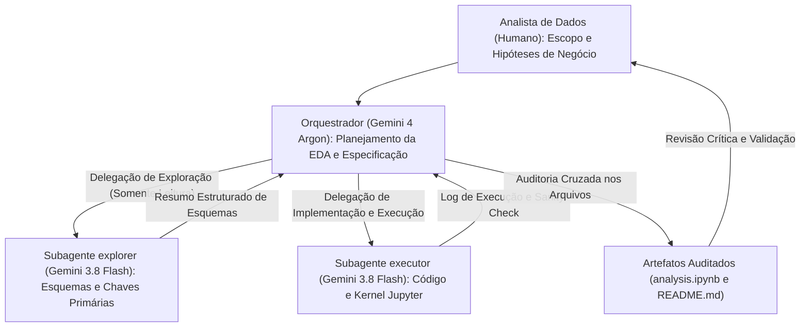
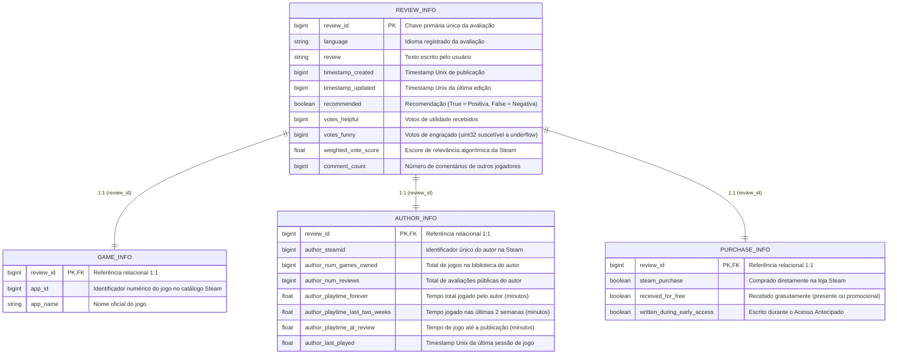
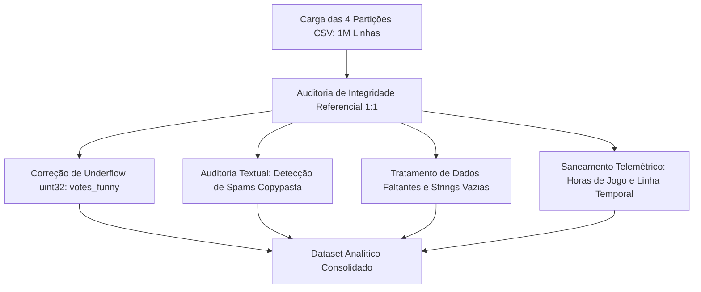
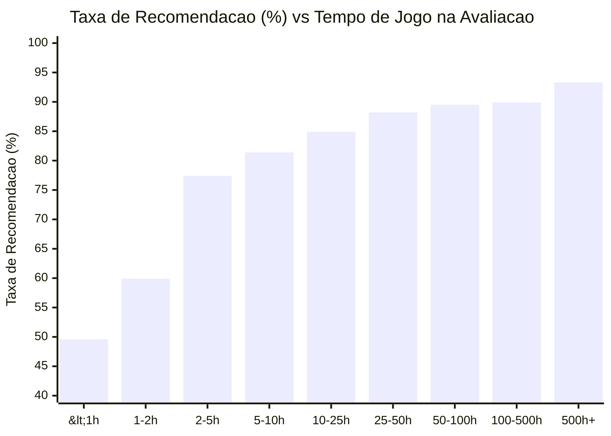

# Steam Game Reviews: Análise Exploratória de Dados (1 Milhão de Reviews)

> Análise exploratória sobre integridade relacional, telemetria de jogadores, comportamento de avaliações e dinâmica de consumo na Steam, aliando a investigação de 1 milhão de registros a uma metodologia prática de análise de dados assistida por agentes de IA.

---

## 1. Visão Geral do Projeto

A Steam é a principal plataforma de distribuição digital de jogos para computadores, com centenas de milhões de usuários ativos mensais e dezenas de milhares de títulos em catálogo. O sistema de avaliações de usuários tem papel central na visibilidade de cada jogo na loja, influenciando o algoritmo de recomendação e as decisões de compra da comunidade.

Este projeto realiza uma Análise Exploratória de Dados (EDA) em um conjunto de 1.000.000 de avaliações de usuários registradas entre março de 2013 e janeiro de 2021. Os dados têm como origem o [Game Reviews Dataset](https://www.kaggle.com/datasets/sridharstreaks/game-reviews-dataset) no Kaggle. O corpus cobre 59 jogos e 912.553 autores distintos, permitindo investigar a consistência dos dados da plataforma, o comportamento de jogadores satisfeitos versus insatisfeitos e os padrões de consumo e tempo de jogo.

Além da investigação empírica sobre o ecossistema da Steam, este repositório documenta uma metodologia prática de **Análise de Dados Assistida por IA** (*AI-Assisted Data Analysis*). Nela, o analista utiliza uma arquitetura em camadas — combinando um modelo orquestrador e revisor de alto raciocínio com subagentes especializados e rápidos de exploração e execução — para investigar bases volumosas mantendo rigor estatístico, reprodutibilidade e higiene da janela de contexto.

### Destaques do Estudo:
* **Escala do Dataset**: 1.000.000 de registros particionados verticalmente em 4 tabelas relacionais com integridade referencial 1:1 estrita.
* **Auditoria e Limpeza de Dados**: Identificação e tratamento de underflow de 32 bits sem sinal (`uint32`) em contadores de votos, textos com milhões de caracteres decorrentes de spam/copypasta, valores nulos e inconsistências na telemetria de horas de jogo.
* **Comportamento e Negócio**: Investigação quantitativa da dinâmica de avaliações negativas ("Economia da Insatisfação"), do efeito direto da política de reembolso de 2 horas da Valve e do impacto de lançamentos em Acesso Antecipado (*Early Access*).
* **Fluxo Analítico com Orquestrador e Subagentes (`AGENTS.md`)**: Adoção de uma arquitetura modular em camadas, separando o raciocínio estratégico e validação estatística da execução pesada de código e leitura de dados volumosos.

---

## 2. Metodologia: Análise de Dados Assistida por IA (`AGENTS.md`)

### 2.1 Por que um `AGENTS.md` Minimalista?
Em projetos de análise de dados orientados a bases massivas — como o presente estudo, que abrange 1 milhão de registros e aproximadamente 481 MB de dados distribuídos em 4 arquivos CSV —, a janela de contexto do modelo principal é o recurso mais sensível. Instruções de sistema longas, repletas de regras genéricas e prescrições abstratas, diluem a atenção do modelo e aumentam o risco de desvios operacionais ou alucinações estatísticas.

O arquivo `AGENTS.md` deste projeto foi estruturado de forma enxuta justamente para atuar como um contrato operacional direto e objetivo. Ele estabelece com clareza:
* **Quando delegar**: Tarefas de varredura ampla de arquivos, exploração de esquemas, execução de testes ou comandos iterativos que poluiriam o contexto principal são direcionadas a subagentes.
* **Como delegar**: Cada despacho deve conter formalmente objetivo, arquivos de trabalho, critérios de pronto e comandos explícitos de verificação.
* **O que deve retornar**: Devoluções concisas contendo apenas caminhos, trechos e resumos para exploração, ou arquivos modificados e relatórios de verificação para execução.

### 2.2 Divisão de Papéis: Orquestrador vs. Subagentes na Ciência de Dados
O uso de agentes monolíticos em ciência de dados frequentemente falha pelo acúmulo desordenado de artefatos intermediários: a leitura integral de múltiplos arquivos, saídas volumosas de comandos no Pandas, tracebacks de depuração e estruturas JSON brutas de notebooks Jupyter degradam rapidamente o contexto analítico. Como consequência, o modelo perde o alinhamento com premissas de negócio e introduz inconsistências métricas.

A estrutura adotada distribui o ciclo de análise em papéis bem definidos:

| Camada | Papel / Modelo | Responsabilidade no Ciclo Analítico | Ganho Prático na Análise |
| :--- | :--- | :--- | :--- |
| **Direção Analítica** | Analista de Dados (Humano) | Formulação do problema, direcionamento de escopo, validação de hipóteses de negócio e revisão crítica. | Mantém o foco estratégico e o julgamento de domínio. |
| **Orquestração e Revisão** | Agente Principal (`Gemini 4 Argon`) | Planejamento das etapas da EDA, escrita das especificações de delegação e auditoria cruzada dos resultados nos arquivos. | Contexto limpo, preservado para raciocínio analítico e verificação de consistência. |
| **Exploração de Dados** | Subagente `explorer` (`Gemini 3.8 Flash`) | Varredura paralela e somente-leitura dos arquivos CSV, mapeamento de chaves (`review_id`), esquemas e volumetria. | Isola leituras pesadas e retorna apenas o resumo estruturado ao orquestrador. |
| **Execução e Sanity Check** | Subagente `executor` (`Gemini 3.8 Flash`) | Escrita das células no `analysis.ipynb`, execução do kernel Jupyter, geração de gráficos e bateria de validação (*Sanity Check*). | Absorve logs de execução e garante que todo número documentado reflita a saída real do código. |

### 2.3 Fluxo de Trabalho e Garantia de Qualidade (Sanity Check)
O fluxo de trabalho estabelece uma cadeia de responsabilidade onde nenhuma conclusão estatística é aceita sem verificação empírica no código:



Essa separação arquitetural permitiu detectar precocemente e tratar com rigor anomalias como o underflow de 32 bits sem sinal (`uint32`) em `votes_funny`, os outliers extremos provocados por textos de copypasta (com milhões de caracteres) e o desalinhamento temporal de telemetria (`playtime_at_review > playtime_forever`), auditando os resultados de cada célula do notebook antes da consolidação final da documentação.

---

## 3. Estrutura do Repositório

O ambiente foi configurado com o gerenciador de dependências [uv](https://github.com/astral-sh/uv), com ambiente virtual determinístico e scripts auxiliares para inicialização do JupyterLab.

> Devido ao limite de tamanho de arquivos no GitHub (com `review_info.csv` superando 360 MB), a pasta `data/` é mantida no `.gitignore`. Para reproduzir a análise, faça o download dos dados no Kaggle ([Game Reviews Dataset](https://www.kaggle.com/datasets/sridharstreaks/game-reviews-dataset)) e posicione os 4 arquivos CSV dentro de `data/`.

```text
game-review/
├── data/                                 # Partições relacionais dos dados (1:1 - baixadas via Kaggle)
│   ├── review_info.csv                   # Texto, votos, recomendação e engajamento (10 colunas, ~364 MB)
│   ├── game_info.csv                     # Identificação dos jogos (app_id e app_name) (3 colunas, ~28 MB)
│   ├── author_info.csv                   # Perfil do autor e telemetria de jogo (8 colunas, ~58 MB)
│   └── purchase_info.csv                 # Forma de aquisição e early access (4 colunas, ~10 MB)
├── scripts/                              # Scripts de inicialização do JupyterLab
│   ├── start-jupyter.ps1                 # Inicialização no Windows PowerShell
│   └── start-jupyter.sh                  # Inicialização no Linux / macOS Bash
├── analysis.ipynb                        # Notebook analítico com validações e visualizações
├── pyproject.toml                        # Definição do projeto e dependências gerenciadas pelo uv
├── AGENTS.md                             # Protocolo operacional e diretrizes de agentes
└── README.md                             # Documentação técnica do projeto
```

---

## 4. Arquitetura Relacional e Dicionário de Dados

### 4.1 Partição Vertical Estrita 1:1
O dataset original foi decomposto em quatro arquivos CSV estruturados sob uma partição vertical estrita indexada pela chave primária `review_id`.

A validação de chaves confirmou:
* **Unicidade**: Cada uma das quatro partições possui exatamente 1.000.000 de registros com 1.000.000 de valores distintos de `review_id`.
* **Integridade Referencial**: A interseção dos identificadores entre as quatro tabelas resulta em exatamente 1.000.000 de chaves, com zero registros órfãos ou ausentes.
* **Alinhamento de Registros**: As quatro tabelas compartilham a mesma ordenação física de linhas, permitindo junções eficientes por chave primária.



### 4.2 Dicionário de Variáveis e Resumo Estrutural

| Partição | Linhas | Colunas | Memória | Variáveis Principais e Descrição |
| :--- | :---: | :---: | :---: | :--- |
| `review_info.csv` | 1.000.000 | 10 | 487,7 MB | `review_id`, `language`, `review`, `timestamp_created`, `timestamp_updated`, `recommended`, `votes_helpful`, `votes_funny`, `weighted_vote_score`, `comment_count`. Métricas textuais e de engajamento comunitário. |
| `game_info.csv` | 1.000.000 | 3 | 82,4 MB | `review_id`, `app_id`, `app_name`. Metadados do catálogo. Contém 59 jogos únicos, com correspondência biunívoca entre `app_id` e `app_name`. |
| `author_info.csv` | 1.000.000 | 8 | 61,0 MB | `review_id`, `author.steamid`, `author.num_games_owned`, `author.num_reviews`, `author.playtime_forever`, `author.playtime_last_two_weeks`, `author.playtime_at_review`, `author.last_played`. População de 912.553 autores únicos (92,47% com 1 review; maior volume por autor é de 22 reviews). |
| `purchase_info.csv` | 1.000.000 | 4 | 10,5 MB | `review_id`, `steam_purchase`, `received_for_free`, `written_during_early_access`. Contexto contratual e modalidade de aquisição do título. |

---

## 5. Auditoria de Qualidade e Limpeza dos Dados (Data Hygiene)

Antes da etapa de análise estatística, os dados passaram por verificação de qualidade para identificar anomalias comuns em telemetria e extração de APIs:



### 1. Correção de Underflow de 32 Bits (`uint32`) em `votes_funny`
* **Causa**: O contador de votos "engraçado" foi serializado na fonte como um inteiro de 32 bits sem sinal (`uint32`). Quando um registro sofria decremento ou contagem negativa na API (por exemplo, -1, -2, -3, -4), ocorria underflow na representação binária, resultando em valores próximos ao teto numérico de $2^{32} - 1 = 4.294.967.295$.
* **Incidência**: 49 registros apresentavam valores entre 4.294.967.292 e 4.294.967.295.
* **Tratamento**: Criação da coluna `votes_funny_clean`, substituindo valores $\ge 4.294.967.292$ por 0. O valor máximo real observado após a correção é de 8.983 votos.

### 2. Detecção de Outliers Extremos de Texto (Spam Copypasta)
* **Causa**: Embora a Steam estipule um limite regular de 8.000 caracteres por avaliação na interface moderna, versões antigas do cliente ou chamadas diretas permitiram publicações de textos contendo repetições maciças em copypasta.
* **Incidência**: Duas avaliações aberrantes apresentaram 9.639.004 caracteres (*Arma 3*) e 4.971.225 caracteres (*For Honor*).
* **Impacto**: Esses dois registros distorciam severamente a média global de comprimento textual (média inflacionada para 265 caracteres com desvio padrão de 10.861). A **mediana real é de 63 caracteres**, com 99% das avaliações abaixo de 2.958 caracteres. Recomenda-se truncamento preventivo em 8.000 caracteres caso os dados sejam utilizados em tarefas de Processamento de Linguagem Natural (NLP).

### 3. Valores Ausentes e Avaliações sem Conteúdo
* **Dados Faltantes**:
  * `review`: 1.294 registros nulos (0,13%), somados a 174 avaliações compostas unicamente por espaços em branco (totalizando 1.468 registros sem texto útil, ou 0,15%).
  * `author.playtime_at_review`: 1.248 registros nulos (0,12%), causados por indisponibilidade de telemetria no instante exato da publicação.
* **Tratamento**: Preenchimento de strings vazias para o campo textual e filtro amostral específico para análises de correlação temporal.

### 4. Inconsistências Telemétricas e Linha Temporal
* **Tempo de Jogo Invertido**: Em 116 registros (0,01%), o tempo registrado no momento da avaliação era superior ao tempo total de jogo acumulado na conta (`playtime_at_review > playtime_forever`). Aplicou-se a barreira não-negativa $\max(0, \text{playtime\_forever} - \text{playtime\_at\_review})$ para calcular o tempo jogado pós-avaliação.
* **Sessão Zerada**: 2 registros possuíam `author.last_played == 0`, correspondendo ao marco zero da era Unix (`1970-01-01 00:00:00 UTC`).
* **Sinalizador de Edições (`is_edited`)**: A comparação entre `timestamp_created` e `timestamp_updated` revelou que 13,11% das avaliações da base foram editadas posteriormente pelo autor.

---

## 6. Principais Descobertas da Análise Exploratória

### 6.1 Concentração de Catálogo e Variação de Aprovação entre Títulos
O conjunto de dados abrange 59 títulos comerciais e apresenta alta concentração de avaliações:
* **Concentração no Top 5**: Apenas 5 jogos (**Arma 3**, **The Elder Scrolls V: Skyrim Special Edition**, **For Honor**, **Darkest Dungeon** e **NieR:Automata**) concentram **54,65% de todas as avaliações** do dataset (546.549 avaliações).
* **Extremos de Satisfação**:
  * **Maior Taxa de Recomendação**: *STEINS;GATE 0* (96,5% positiva), *The Legend of Heroes: Trails of Cold Steel II* (95,2%) e *Farm Together* (93,8%).
  * **Menor Taxa de Recomendação**: *SOS* (27,8% positiva), *DYNASTY WARRIORS 9* (31,2%) e *Bless Online* (38,0%).

---

### 6.2 O Comportamento das Avaliações Negativas ("Economia da Insatisfação")
No geral, o sentimento na plataforma é amplamente positivo (**82,97% de recomendações positivas** contra **17,03% de negativas**). No entanto, a análise do comportamento dos usuários mostra que avaliações negativas mobilizam um engajamento significativamente mais intenso:

| Métrica Analisada | Avaliação Positiva | Avaliação Negativa | Comparação Direta |
| :--- | :---: | :---: | :--- |
| Proporção na base | 82,97% | 17,03% | ~4,9 para 1 |
| Probabilidade de receber voto útil (> 0) | 31,6% | 63,3% | 2,0x mais provável |
| Média de votos úteis recebidos | 2,56 votos | 7,08 votos | 2,8x mais votos úteis |
| Mediana do tamanho do texto | 57 caracteres | 112 caracteres | ~2,0x mais longo |
| Média de comentários recebidos | 0,13 comentários | 0,55 comentários | 4,25x mais comentários |
| Mediana de tempo jogado pós-avaliação | 13,98 horas | 1,18 horas | 11,8x menos tempo jogado |

Usuários frustrados tendem a escrever textos com o dobro do tamanho mediano, detalhando problemas técnicos, balanceamento ou modelos de monetização. A comunidade responde a esse conteúdo com o dobro da taxa de votos úteis e mais de quatro vezes o volume médio de comentários. Além disso, a publicação de uma análise negativa funciona como um forte sinal de abandono do jogo: a mediana de tempo adicional jogado após a review é de apenas 1,18 hora, frente a quase 14 horas de jogadores que avaliaram positivamente.

---

### 6.3 O Efeito da Janela de Reembolso de 2 Horas da Steam
A Valve oferece reembolso automático integral caso o usuário tenha jogado por **menos de 2 horas**. Essa política deixa marcas claras no comportamento avaliativo ao longo das faixas de tempo:



1. **Abaixo de 2 Horas**: Jogadores com menos de 1 hora de jogo recomendam o título em apenas **49,6%** das vezes. Na faixa de 1 a 2 horas, a aprovação sobe para **59,9%**.
2. **Pico de Votos Úteis**: Essas avaliações precoces concentram a maior média de votos úteis de toda a base (**4,77 votos por review**), indicando que outros compradores as utilizam ativamente como alerta antes de comprar.
3. **Pós-2 Horas**: Uma vez ultrapassado o limite de reembolso, o jogador que permaneceu no jogo já demonstrou interesse inicial. A aprovação sobe para **77,4%** (2 a 5 horas) e cresce de maneira contínua até atingir **93,3%** entre jogadores com mais de 500 horas de jogo.

---

### 6.4 Canal de Compra, Acesso Antecipado e Avaliações Editadas
* **Penalidade de Early Access**: Avaliações escritas durante o período de Acesso Antecipado registram aprovação de **69,8%**, contra **83,8%** em títulos já lançados em versão estável — uma diferença de 14,0 pontos percentuais.
* **Avaliações Editadas**: Os **13,11%** de autores que atualizaram suas avaliações apresentam taxa de recomendação menor (**74,3% vs 84,3%**), textos quatro vezes maiores em média (769,9 vs 188,9 caracteres) e recebem 3,3 vezes mais votos úteis (**8,43 vs 2,56**).
* **Modalidade de Aquisição**: Compras feitas diretamente na loja Steam têm **83,8%** de aprovação, enquanto chaves de ativação externa registram **81,2%**. Jogos recebidos gratuitamente registram **78,7%** de recomendação (contra **83,2%** em jogos pagos).

---

### 6.5 Perfil do Crítico Veterano e Panorama por Idioma
* **Perfil do Crítico Veterano**: Usuários que escrevem muitas avaliações tornam-se progressivamente mais criteriosos:
  * Autores com 1 avaliação na conta: **84,9% de aprovação** e média de 2,14 votos úteis.
  * Autores com mais de 50 avaliações: **76,8% de aprovação** (queda de 8,1 p.p.), porém com maior reconhecimento da comunidade (**7,09 votos úteis**, aumento de 3,3x).
* **Distribuição por Idioma**:
  * **Inglês**: 49,1% da base, 83,7% de aprovação e média de 3,07 votos úteis.
  * **Chinês Simplificado**: 15,1% da base, 76,6% de aprovação e média de 6,15 votos úteis.
  * **Russo**: 8,7% da base, 82,1% de aprovação e média de 4,02 votos úteis.
  * **Português Brasileiro**: 2,8% da base (27.965 avaliações), 88,2% de aprovação e média de 2,11 votos úteis.

---

### 6.6 Sazonalidade e Promoções da Steam
A evolução temporal mensal entre 2017 e 2020 confirma picos pronunciados de novas avaliações coincidentes com as grandes promoções anuais da Valve:
* **Steam Summer Sale** (junho/julho): Picos em **junho de 2018 (40.674 reviews)** e **julho de 2019 (33.620 reviews)**.
* **Steam Autumn & Winter Sales** (novembro/dezembro): Picos em **novembro de 2018 (40.418 reviews)**, **novembro de 2019 (46.169 reviews — maior volume mensal registrado)** e **dezembro de 2019 (34.410 reviews)**.

---

## 7. Como Executar e Reproduzir

### 7.1 Pré-requisitos
* [Python](https://www.python.org/) 3.12 ou superior (testado no Python 3.14)
* [uv](https://docs.astral.sh/uv/) (gerenciador de dependências e ambientes virtuais Python)

### 7.2 Clonagem e Preparação dos Dados
1. Clone o repositório e sincronize o ambiente virtual com as dependências:
   ```bash
   git clone https://github.com/EmersonPalatti/game-review.git
   cd game-review
   uv sync
   ```

2. Baixe o conjunto de dados no Kaggle: [Game Reviews Dataset](https://www.kaggle.com/datasets/sridharstreaks/game-reviews-dataset).
3. Extraia e copie os 4 arquivos CSV para o diretório `data/` na raiz do projeto:
   * `data/review_info.csv`
   * `data/game_info.csv`
   * `data/author_info.csv`
   * `data/purchase_info.csv`

### 7.3 Executando o JupyterLab
O repositório inclui scripts de conveniência para iniciar o servidor JupyterLab:

* **Windows (PowerShell)**:
  ```powershell
  .\scripts\start-jupyter.ps1
  ```
* **Linux / macOS (Bash)**:
  ```bash
  chmod +x ./scripts/start-jupyter.sh
  ./scripts/start-jupyter.sh
  ```

O servidor será disponibilizado em `http://127.0.0.1:8888/?token=agentic`.

### 7.4 Execução Não-Interativa via CLI
Para executar todas as células do notebook sequencialmente e atualizar as saídas via linha de comando:

```bash
uv run jupyter nbconvert --to notebook --execute analysis.ipynb --inplace
```

---

## 8. Tecnologias Utilizadas
* **Linguagem**: Python
* **Análise e Manipulação de Dados**: [Pandas](https://pandas.pydata.org/) e [NumPy](https://numpy.org/)
* **Visualização de Dados**: [Matplotlib](https://matplotlib.org/) e [Seaborn](https://seaborn.pydata.org/)
* **Ambiente Interativo**: [JupyterLab](https://jupyter.org/) e `ipykernel`
* **Gerenciamento de Ambiente**: [uv](https://docs.astral.sh/uv/)
* **Fluxo Analítico Assistido por IA**: Arquitetura Orquestrador (`Gemini 4 Argon`) + Subagentes `explorer` / `executor` (`Gemini 3.8 Flash`) regida via `AGENTS.md`.

---

## 9. Autor
Projeto desenvolvido por [Emerson Palatti](https://github.com/EmersonPalatti).
